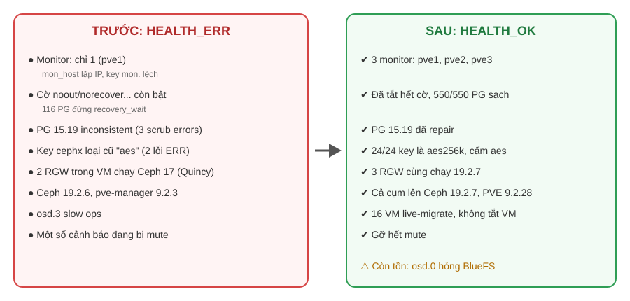

# Cụm lab ClusterTamm: từ HEALTH_ERR về HEALTH_OK (11/2026)

[← Mục lục](../../../README.md) · Case study Ceph

**Cụm:** 3 node `pve1`, `pve2`, `pve3` · Proxmox VE 9.2 · Ceph Squid 19.2 · 6 OSD · 3 RGW (1 trên `pve3`, 2 trong VM `S3-GW` (VM 102) và `S3-GW-02` (VM 110) chạy trên `pve3`).

**Tóm tắt:** cụm báo HEALTH_ERR do nhiều lỗi cũ chồng lên nhau: cờ bảo trì quên tắt, PG lỗi, chỉ còn 1 monitor, và cảnh báo bảo mật key cephx của Ceph 19.2.6. Đã sửa hết. Còn tồn: osd.0 hỏng BlueFS.

**Từ khóa:** `HEALTH_ERR` · ceph health err · cụm ceph lỗi · proxmox ceph lỗi · ClusterTamm · squid 19.2 · cephx · aes256k · tổng hợp sự cố ceph



## Bảng tóm tắt lỗi

| # | Lỗi | Nguyên nhân | Cách fix |
|---|---|---|---|
| 1 | 116 PG đứng `recovery_wait` | Cờ `noout,norecover,...` quên tắt sau lần bảo trì trước | Tắt cờ theo thứ tự |
| 2 | PG `15.19` inconsistent, 3 scrub errors | Bản sao trên osd.0 (ổ từng lỗi) không khớp | `ceph pg repair` |
| 3 | Chỉ có 1 monitor | `mon_host` lặp IP, `ceph.conf` còn monitor cũ, key `mon.` lệch | Dọn cấu hình, đồng bộ key, tạo lại monitor |
| 4 | HEALTH_ERR "insecure key types" | Ceph 19.2.6 coi key `aes` cũ là không an toàn | Đổi toàn bộ key sang `aes256k` |
| 5 | Không có công cụ đổi key | pve-manager 9.2.3 quá cũ | Cập nhật PVE, restart lần lượt daemon |
| 6 | Công cụ đổi key báo `MON_DISK_LOW` | Ổ hệ thống pve1 còn khoảng 30% | Hạ ngưỡng `mon_data_avail_warn` xuống 20 |
| 7 | 2 RGW không dùng được key mới | VM gateway chạy Ceph 17 (Quincy) | Nâng lên Ceph 19.2.7 |
| 8 | VM giữ key admin cũ | Ổ krbd nhớ key lúc map | Live-migrate VM đi rồi về |
| 9 | Gateway mất xác thực sau khi fix | VM còn bản sao key cũ ở `/etc/pve/priv/` | Cập nhật đúng file key |
| 10 | osd.0 crash (**còn tồn**) | Metadata BlueFS trên ổ OCZ bị hỏng | Thử fsck / bộ cấp phát bitmap, hoặc thay ổ |

## Thứ tự đã làm thực tế

1. Mục 1 → mục 2 (dữ liệu sạch trước).
2. Mục 5: cập nhật PVE cả 3 node.
3. Mục 3: sửa monitor (lên 3 monitor).
4. Mục 5: restart lần lượt daemon.
5. Mục 6 → mục 4 phần A (key của cụm).
6. Mục 7 (gateway) → mục 4 phần B (key admin) → mục 8 (migrate VM) → mục 4 phần C (chốt, cấm `aes`).
7. Hôm sau: mục 9.

> Tất cả lệnh chạy trên `pve1` (Shell của web GUI) nếu không ghi khác. `ssh pveX` là chạy sang node khác.

## 1. Cờ bảo trì quên tắt

**Triệu chứng:** `noout,nobackfill,norebalance,norecover,noscrub,nodeep-scrub flag(s) set`, PG đứng `recovery_wait` mãi không giảm.

**Từ khóa:** `OSDMAP_FLAGS` · `flag(s) set` · `recovery_wait` · norecover · nobackfill · noout · unset flag · recovery không chạy · PG đứng yên · quên tắt cờ

**Nguyên nhân:** cờ được bật lúc xử lý sự cố OSD hôm 02/11 rồi quên tắt. Có `norecover` thì Ceph không chép lại bản sao.

**Lệnh đã chạy:** Kiểm tra trước: OSD nào trên 85% thì xử lý chỗ trống trước.

```
ceph osd df
ceph osd unset norecover
ceph osd unset nobackfill
ceph osd unset norebalance
ceph osd unset noscrub
ceph osd unset nodeep-scrub
ceph osd unset noout
```

**Để ý:** bảo trì xong luôn chạy `ceph osd dump | grep flags`.

**Từ khóa:** noout, norecover, nobackfill, norebalance, noscrub, nodeep-scrub, recovery_wait.

## 2. PG inconsistent

**Triệu chứng:** `3 scrub errors`, `pg 15.19 is active+clean+inconsistent`.

**Cách fix:**

```
ceph health detail | grep inconsistent
ceph pg repair 15.19
```

**Để ý:** pool `size 2` rất dễ lỗi kiểu này. Dữ liệu quan trọng nên dùng `size 3 / min_size 2`.

**Từ khóa:** pg inconsistent, scrub errors, pg repair, scrub, pool size.

## 3. Chỉ có 1 monitor

**Triệu chứng:** `ceph mon stat` chỉ có `pve1`. Tạo monitor mới thì lỗi `Address already in use` hoặc `Permission denied`.

**Nguyên nhân:** 4 lỗi cũ chồng nhau:

- `mon_host` lặp IP (do `pveceph mon create` tự thêm IP đã có).
- `ceph.conf` còn `[mon.pve2]`, `[mon.pve3]` cũ.
- `public_network` khai báo 3 dải trùng nhau.
- Key `mon.` trong file trên đĩa khác key trong database xác thực.

**Cách fix:**

1. Sao lưu `/etc/pve/ceph.conf`, tắt dịch vụ monitor hỏng, cất thư mục cũ (không xóa).
2. Sửa `mon_host` chỉ còn IP monitor đang chạy, `public_network = 192.168.70.0/24`.
3. So key `mon.` (so mã hash, không in key):

```
ceph auth get mon. | awk '/key =/{print $3}' | md5sum
awk '/key =/{print $3}' /var/lib/ceph/mon/ceph-pve1/keyring | md5sum
```

4. Nếu lệch: lấy key từ `ceph auth get mon.` ghi vào keyring monitor và `/etc/pve/priv/ceph.mon.keyring`.
5. Tạo từng monitor một, mỗi lần kiểm tra `ceph mon stat`.

**Để ý:** file trong `/etc/pve` ghi bằng `cat > file`, không dùng `sed -i`.

**Từ khóa:** mon_host, public_network, monitor, mon key, keyring, Address already in use, Permission denied.

## 4. Cảnh báo "insecure key types"

**Triệu chứng:** 6 cảnh báo `AUTH_INSECURE_*`, trong đó 2 cái là ERR.

**Nguyên nhân:** bản vá bảo mật Ceph 19.2.6 yêu cầu chuyển key từ `aes` sang `aes256k`.

**Cách fix:** dùng công cụ của Proxmox, luôn chạy thử trước rồi mới `--apply`.

```
H=/usr/share/pve-manager/migrations/pve-cephx-rotate-service-keys
pveceph auth status
$H --rotate-cluster-keys --apply                       # key mon/mgr/osd/mds
$H --rotate-all-storage-keys --rotate-admin-key --apply # staging key admin
$H                                                      # xem còn client nào dùng key cũ
$H --apply --confirm-clients-refreshed client.admin     # chốt key admin
$H --apply --restrict-ciphers                           # cấm hẳn aes
```

**Để ý:**

- Công cụ hỏi `(y/N)`. Đừng dẫn output qua `| tail` hay `| grep`, vì câu hỏi bị ẩn và lệnh tự hủy.
- Đừng rời trang Shell của web GUI khi công cụ đang chạy.
- ⚠ Sau `--restrict-ciphers`, client nào còn key cũ sẽ mất kết nối ngay.
- Cảnh báo `ROTATING_SERVICE_KEY_TYPE` còn lại sẽ tự hết sau vài giờ.

**Từ khóa:** cephx, aes, aes256k, insecure key types, AUTH_INSECURE, rotate cluster keys, restrict ciphers.

## 5. Cập nhật PVE và restart daemon

**Cách fix:** bật `noout`, `apt dist-upgrade` từng node, rồi restart theo thứ tự mon → mgr → OSD (từng node, đợi PG sạch) → mds → rgw. Kiểm tra bằng `ceph versions`.

**Để ý:** đừng gõ lệnh khác vào terminal khi `apt` đang chạy.

**Từ khóa:** PVE upgrade, apt dist-upgrade, ceph versions, daemon restart, PVE 9.2.

## 6. MON_DISK_LOW chặn công cụ

**Cách fix:** dọn cache hoặc hạ ngưỡng nếu chỗ trống thực tế vẫn đủ.

```
apt-get clean
ceph config set mon mon_data_avail_warn 20
```

**Từ khóa:** MON_DISK_LOW, mon_data_avail_warn, disk space, monitor disk low.

## 7. RGW trong VM chạy Ceph cũ

**Nguyên nhân:** VM Ubuntu 22.04 cài Ceph 17 từ kho Ubuntu, không hỗ trợ `aes256k`.

**Cách fix:** thêm kho `download.ceph.com/debian-squid` (jammy), nâng `radosgw ceph-common` lên 19.2.7, rồi đổi key RGW. Làm từng gateway một. Không SSH được thì dùng guest-agent:

```
qm guest exec <vmid> --timeout 60 --pass-stdin 1 -- bash < script.sh
```

**Từ khóa:** RGW, Ceph Quincy, Ceph Squid, aes256k, radosgw, client key.

## 8. VM giữ key admin cũ

**Nguyên nhân:** storage `storagevm` bật `krbd`, mỗi VM đang chạy giữ kết nối kernel đã xác thực bằng key cũ. Reboot trong VM không đủ.

**Cách fix:** live-migrate từng VM sang node khác rồi chuyển về: `qm migrate <vmid> <node> --online`. 16 VM, không VM nào bị tắt.

**Từ khóa:** krbd, live migrate, client admin key, VM keyring, cephx.

## 9. Gateway mất xác thực sau khi fix

**Triệu chứng:** trong VM gateway, `ceph -s` báo `handle_auth_bad_method ... (13) Permission denied`, nhưng chạy với `-k /etc/ceph/ceph.client.admin.keyring` thì được.

**Nguyên nhân:** `ceph.conf` trong VM có `keyring = /etc/pve/priv/$cluster.$name.keyring`, và trong VM có bản sao cũ ở đúng đường dẫn đó.

**Cách fix:** tìm file key CLI đang nạp và cập nhật nó.

```
ceph -s --debug_auth=5 2>&1 | grep -oE 'loaded key file [^ ]+'
```

**Để ý:** trước khi cấm key cũ, dò hết file keyring trên mọi máy client.

**Từ khóa:** RADOS permission denied, handle_auth_bad_method, loaded key file, ceph.keyring, auth bad method.

## 10. osd.0 crash (còn tồn)

**Triệu chứng:** osd.0 crash liên tục rồi dừng hẳn. Các OSD khác đầy lên 85–92%, `backfill_toofull`, PG `16.11` inactive.

**Nguyên nhân:** crash ở `BlueFS::mount` → `AvlAllocator`. Metadata trên ổ OCZ hỏng, ổ này đã lỗi rocksdb hôm 02/11.

**Hướng xử lý:**

```
ceph-bluestore-tool fsck --path /var/lib/ceph/osd/ceph-0
ceph config set osd.0 bluestore_allocator bitmap
ceph config set osd.0 bluefs_allocator bitmap
systemctl reset-failed ceph-osd@0 && systemctl start ceph-osd@0
```

Không cứu được thì `ceph osd out 0`, xóa OSD, thay ổ, tạo OSD mới.

**Từ khóa:** osd crash, BlueFS, AvlAllocator, bluestore, ceph-bluestore-tool fsck, bitmap allocator.

## Bài học

**Từ khóa:** maintenance flags, monitor quorum, cephx, keyring, capacity, upgrade Tentacle.

- Bảo trì xong phải tắt cờ và gỡ mute.
- Đừng mute lỗi ERR để che, phải sửa tận gốc.
- Luôn có 3 monitor.
- Trước khi đổi key: tìm hết client và bản sao key, kể cả trong VM.
- Cụm dùng quá 70% dung lượng thì mất 1 OSD là các OSD khác đầy ngay.
- Ceph 19.2 (Squid) đã hết hỗ trợ, nên lên 20.2 (Tentacle).
