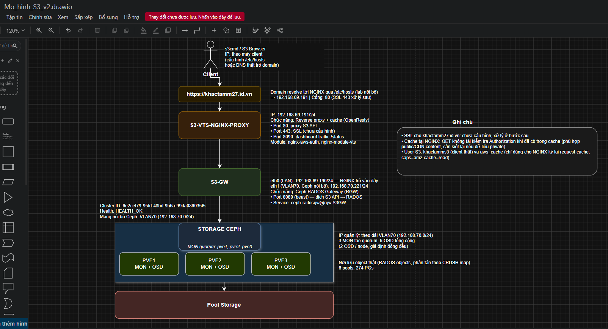
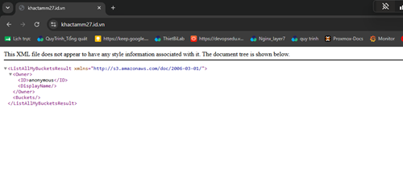
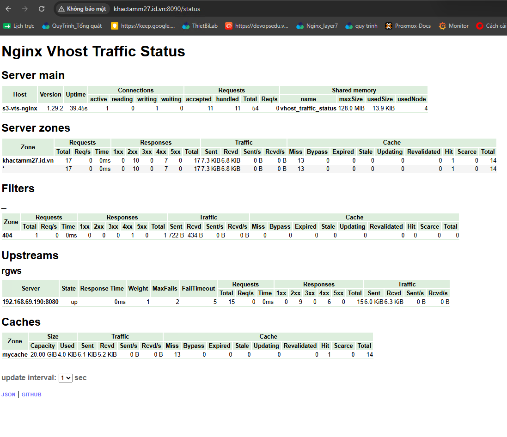

# Ceph S3 Gateway qua NGINX reverse proxy và cache (OpenResty, aws-auth, VTS)

> **Phạm vi:** dựng Ceph RADOS Gateway (RGW) trên VM riêng, đặt NGINX (OpenResty) phía trước làm reverse proxy, cache object và dashboard traffic (nginx-vts); kiểm thử bằng s3cmd và S3 Browser qua domain `khactamm27.id.vn`.
> **Trạng thái:** đã chạy trên lab, kiểm thử end-to-end đạt (tạo bucket, upload, list, download qua proxy). Mục 5 liệt kê các điểm cần kiểm tra thêm trước khi dùng cho dữ liệu thật. Ngày cập nhật: 2026-10-24.
> **Bộ file đi kèm** (thư mục [`tools/s3-nginx-cache/`](../../tools/s3-nginx-cache/)): `build-openresty.sh`, `nginx.conf`, `nginx-lua-file.lua`, `conf.d/nginx-default.conf`, `conf.d/nginx-vts-status.conf`, `nginx.service`, `s3cfg.example`.
> **Lưu ý:** IP, domain và tên user là của lab. Secret key không lưu trong repo; các file mẫu để chỗ trống `<SECRET_KEY_...>`.

---

## 0. Tóm tắt nhanh

| Câu hỏi | Trả lời |
|---|---|
| Làm gì? | Cho client dùng S3 API của Ceph qua một domain, có lớp cache để giảm tải đọc xuống RGW/Ceph |
| Dùng gì? | Ceph RGW (beast, cổng 8080) + OpenResty 1.29.2.1 với `nginx-aws-auth-module` và `nginx-module-vts` |
| Cache cái gì? | Chỉ `GET` object (không có query string). List bucket, `PUT`, `POST`, `HEAD`, `DELETE`, `COPY` luôn đi thẳng tới RGW |
| Xác thực thế nào? | `GET` có chữ ký SigV4 được NGINX gửi chữ ký gốc lên RGW kiểm tra (subrequest) trước khi trả object, kể cả khi object đã có trong cache |
| Xem traffic ở đâu? | `http://khactamm27.id.vn:8090/status` (nginx-vts: request, mã lỗi, cache hit/miss, trạng thái upstream) |
| Phù hợp với | Nội dung đọc nhiều; **chưa phù hợp với dữ liệu private** nếu chưa xử lý mục 5.1 |

Bài này là phần proxy/cache. Giám sát ops theo từng S3 user nằm ở bài [Giám sát S3 user ops bằng Ceph RGW Usage Exporter](s3-rgw-usage-monitoring.md). Hai bài dùng chung S3-GW `192.168.69.190:8080`.

---

## 1. Mô hình hiện tại

### 1.1 Sơ đồ



```
Client (s3cmd, S3 Browser)        /etc/hosts: khactamm27.id.vn -> 192.168.69.191
        │  HTTP :80, S3 API, path-style
        ▼
S3-VTS-NGINX  192.168.69.191      OpenResty: reverse proxy + cache (/data/cache, 20 GB)
        │  :8090/status           dashboard nginx-vts
        │  HTTP :8080
        ▼
S3-GW  eth0 192.168.69.190        Ceph RGW (beast :8080), service ceph-radosgw@rgw.S3GW
       eth1 192.168.70.221        VLAN70, mạng nội bộ Ceph
        │  RADOS
        ▼
Ceph cluster  PVE1 / PVE2 / PVE3  3 MON (quorum), 6 OSD (2 OSD/node), 6 pool, 274 PG, HEALTH_OK
```

### 1.2 Bảng node, IP và vai trò

| Node | Vai trò | Interface | Địa chỉ IP | Ghi chú |
|---|---|---|---|---|
| PVE1 / PVE2 / PVE3 | Ceph MON + OSD | VLAN70 | 192.168.70.0/24 | Cluster ID `6e2cef79-95fd-48bd-9b6a-99da086035f5`, HEALTH_OK, 3 MON quorum, 6 OSD |
| S3-GW | Ceph RGW | eth1 (VLAN70) | 192.168.70.221/24 | Kết nối nội bộ tới MON/OSD |
| S3-GW | Ceph RGW | eth0 (LAN) | 192.168.69.190/24 | NGINX trỏ upstream vào đây, cổng 8080 |
| S3-VTS-NGINX | Reverse proxy + cache | eth0 (LAN) | 192.168.69.191/24 | Domain trỏ vào đây; cổng 80 (S3), 8090 (dashboard) |
| Client | Kiểm thử s3cmd / S3 Browser | | theo máy client | `/etc/hosts` trỏ domain về 192.168.69.191 |

### 1.3 User S3

| UID | Mục đích | Access key | Caps |
|---|---|---|---|
| `khactamms3` | User client thật, dùng cho s3cmd và S3 Browser | `WZ3HXFFJ4FEX8SUV0E3L` | Mặc định (đọc, ghi, xóa object của chính user) |
| `aws_cache` | NGINX dùng để ký lại request `GET` object khi đọc lên cache | `QTTT3AJFJGE9Y5G7M9AQ` | `amz-cache=read` |

Secret key nằm trong `~/.s3cfg` của client và `/etc/nginx/nginx.conf` trên proxy, không ghi trong bài này.

### 1.4 Đường dẫn quan trọng

| Máy | Đường dẫn | Nội dung |
|---|---|---|
| S3-GW | `/etc/ceph/ceph.conf` | Cấu hình Ceph, có mục `[client.rgw.S3GW]` |
| S3-GW | `/var/lib/ceph/radosgw/ceph-rgw.S3GW/keyring` | Keyring của RGW |
| S3-VTS-NGINX | `/etc/nginx/nginx.conf` | Cấu hình chính, khóa của `aws_cache`, các `map` chọn header Authorization |
| S3-VTS-NGINX | `/etc/nginx/nginx-lua-file.lua` | Script Lua tạo header `X-Amz-Cache` |
| S3-VTS-NGINX | `/etc/nginx/conf.d/nginx-default.conf` | Upstream, cache, server cổng 80 |
| S3-VTS-NGINX | `/etc/nginx/conf.d/nginx-vts-status.conf` | Dashboard cổng 8090 |
| S3-VTS-NGINX | `/data/cache` | Dữ liệu cache (tối đa 20 GB, xóa sau 1 ngày không dùng) |
| S3-VTS-NGINX | `/var/lib/nginx/{body,proxy,...}` | Thư mục tạm, phải tạo tay (mục 4.4) |
| Client | `~/.s3cfg` | Cấu hình s3cmd |

### 1.5 Quá trình dựng (đã làm) và hiện trạng

1. S3-GW join Ceph cluster bằng `ceph.conf` và keyring admin chép từ node PVE; sửa đường dẫn keyring đặc thù Proxmox.
2. Cài RGW, tạo keyring `client.rgw.S3GW`, chạy beast cổng 8080. Truy cập thẳng `http://192.168.69.190:8080` trả XML `ListAllMyBucketsResult` (ảnh dưới).
3. Tạo user `khactamms3` và `aws_cache`.
4. Build OpenResty 1.29.2.1 kèm hai module, tạo thư mục tạm, service systemd.
5. Cấu hình proxy, cache, dashboard VTS.
6. Client trỏ domain bằng `/etc/hosts`, kiểm thử s3cmd (tạo bucket, upload, list, download: **đạt**) và S3 Browser (path-style, không SSL: **đạt**, quản lý được ACL).





Dashboard VTS lúc chụp: upstream `192.168.69.190:8080` **up**, cache `mycache` 13 MISS / 1 HIT, 7 phản hồi 4xx (gồm các request ẩn danh bị 403, xem mục 6).

---

## 2. Cơ chế và luồng hoạt động

### 2.1 Mỗi loại request đi đường nào

| Request | Subrequest xác thực `/authentication` | Cache | Header `Authorization` gửi lên RGW |
|---|---|---|---|
| `GET /bucket/object` có chữ ký **SigV4** | **Có**: gửi chữ ký gốc lên RGW kèm `x-rgw-auth: yes`; RGW từ chối thì trả 403 | Có (200, 206 giữ 1 ngày) | Chữ ký của `aws_cache` + header `X-Amz-Cache` chứa chữ ký gốc |
| `GET /bucket/object` **không chữ ký** (ẩn danh) hoặc chữ ký SigV2 | **Không** (`return 200`) | Có | Chữ ký của `aws_cache`, `X-Amz-Cache` rỗng |
| `GET /` (list bucket) hoặc URL có `?` (list object, ACL...) | Không | Không | Chữ ký gốc của client |
| `PUT`, `POST`, `HEAD`, `DELETE`, `COPY`, có `If-Match` | Không | Không | Chữ ký gốc của client |

### 2.2 Luồng `GET` object có chữ ký

1. Client gửi `GET /buckettest2/test2.txt` có `Authorization: AWS4-HMAC-SHA256 ...`.
2. `rewrite_by_lua_file` gom các header đã ký và chữ ký gốc vào biến `authvar`.
3. `auth_request /authentication`: NGINX gửi một subrequest cùng URL, cùng method, kèm chữ ký gốc và `x-rgw-auth: yes` lên RGW. RGW trả lỗi (403) thì client nhận 403; RGW trả 404 thì client nhận 403 (`@outage`).
4. Qua bước 3, NGINX tra cache theo khóa `$request_uri$request_method$request_body`:
   - **HIT**: trả object từ `/data/cache`, header `X-Cache-Status: HIT`.
   - **MISS**: gửi request lên RGW, ký bằng `aws_cache`, kèm `X-Amz-Cache: <chữ ký gốc>`; RGW dựa vào caps `amz-cache` để kiểm tra quyền theo user gốc, trả object; NGINX lưu cache rồi trả client.
5. Nhiều client cùng xin một object chưa có trong cache: `proxy_cache_lock` chỉ cho một request lên RGW, các request khác chờ.

Vì bước 3 nằm trước bước tra cache, **mỗi `GET` có chữ ký vẫn tạo một request tới RGW** để xác thực, kể cả khi HIT. Cache giảm được phần đọc dữ liệu object từ Ceph, không giảm số request xác thực (kiểm chứng ở mục 5.2).

### 2.3 Vai trò từng thành phần

| Thành phần | Vai trò |
|---|---|
| `nginx-aws-auth-module` (`aws_auth $aws_token`) | Tính chữ ký SigV4 bằng khóa `aws_cache` cho request gửi lên RGW |
| Các `map` `$awsauth` → `$awsauthfour` | Chọn gửi chữ ký `aws_cache` (chỉ `GET` object) hay chữ ký gốc của client (mọi trường hợp khác) |
| `nginx-lua-file.lua` | Tạo giá trị header `X-Amz-Cache` từ chữ ký gốc |
| `auth_request /authentication` | Kiểm tra quyền của client với RGW trước khi trả object |
| `proxy_cache mycache` | Cache object; `proxy_cache_use_stale updating` + `background_update` trả bản cũ trong lúc làm mới |
| `limit_req` | Giới hạn 100 request/giây mỗi IP client, cho vượt tạm 20 |
| `nginx-module-vts` | Đếm request, mã phản hồi, byte, cache hit/miss theo server/upstream; xuất HTML, JSON, Prometheus |

---

## 3. Chuẩn bị

| # | Cần có | Cách kiểm tra |
|---|---|---|
| 1 | Ceph cluster HEALTH_OK, có quyền root trên một node PVE | `ceph -s` |
| 2 | VM S3-GW: một NIC vào mạng Ceph (VLAN70), một NIC LAN | `ip -br a` |
| 3 | VM S3-VTS-NGINX trên LAN, đủ đĩa cho `/data/cache` (20 GB + upload đang ghi tạm, mục 5.3) | `df -h /data` |
| 4 | Đồng bộ giờ trên mọi máy (SigV4 từ chối request lệch quá 15 phút) | `chronyc tracking` |
| 5 | Client trỏ domain về proxy | `getent hosts khactamm27.id.vn` |

---

## 4. Triển khai

### 4.1 S3-GW: join Ceph cluster

```bash
apt install -y ceph-common
scp root@<IP-MON>:/etc/ceph/ceph.conf /etc/ceph/
scp root@<IP-MON>:/etc/pve/priv/ceph.client.admin.keyring /etc/ceph/ceph.client.admin.keyring
chmod 600 /etc/ceph/ceph.client.admin.keyring

# ceph.conf của Proxmox trỏ keyring về /etc/pve/priv/..., đường dẫn này chỉ có trên node PVE
sed -i '/keyring = \/etc\/pve\/priv/d' /etc/ceph/ceph.conf
ceph -s        # phải thấy HEALTH_OK
```

### 4.2 S3-GW: cài và chạy RGW

```bash
apt install -y radosgw
mkdir -p /var/lib/ceph/radosgw/ceph-rgw.S3GW
ceph auth get-or-create client.rgw.S3GW mon 'allow rw' osd 'allow rwx' \
  -o /var/lib/ceph/radosgw/ceph-rgw.S3GW/keyring
```

Thêm cuối `/etc/ceph/ceph.conf`:

```ini
[client.rgw.S3GW]
host = S3-GW
rgw_frontends = "beast port=8080"
keyring = /var/lib/ceph/radosgw/ceph-rgw.S3GW/keyring
```

```bash
systemctl enable --now ceph-radosgw@rgw.S3GW
ss -ltnp | grep 8080                       # radosgw đang nghe
curl -s http://192.168.69.190:8080         # XML ListAllMyBucketsResult (owner anonymous)
```

### 4.3 S3-GW: tạo user S3

```bash
radosgw-admin user create --uid=khactamms3 --display-name="Khac Tam S3"
radosgw-admin user create --uid=aws_cache --display-name="NGINX cache" --caps="amz-cache=read"
radosgw-admin user info --uid=aws_cache    # kiểm tra caps amz-cache=read, lấy access/secret key
```

### 4.4 S3-VTS-NGINX: build OpenResty

Script [`build-openresty.sh`](../../tools/s3-nginx-cache/build-openresty.sh) gói toàn bộ bước build: cài gói, tải OpenResty và hai module, `./configure` đầy đủ cờ, `gmake install`, link `/usr/sbin/nginx`, tạo thư mục tạm `/var/lib/nginx/*` và `/data/cache`.

```bash
bash build-openresty.sh                    # OPENRESTY_VERSION=1.29.2.1 mặc định
nginx -V 2>&1 | grep -o 'add-module=[^ ]*'  # phải thấy nginx-aws-auth-module và nginx-module-vts
```

Script dùng một biến phiên bản cho cả `wget` và `tar` vì tài liệu gốc từng tải 1.29.2.1 nhưng lại giải nén 1.15.8.3.

### 4.5 S3-VTS-NGINX: cấu hình và chạy

```bash
cp nginx.conf nginx-lua-file.lua /etc/nginx/
cp conf.d/nginx-default.conf conf.d/nginx-vts-status.conf /etc/nginx/conf.d/
cp nginx.service /etc/systemd/system/
nano /etc/nginx/nginx.conf                 # điền secret_key của aws_cache
chmod 600 /etc/nginx/nginx.conf            # file chứa khóa; tiến trình master chạy root nên vẫn đọc được

nginx -t
systemctl daemon-reload
systemctl enable --now nginx
```

### 4.6 Client

`/etc/hosts` (Windows: `C:\Windows\System32\drivers\etc\hosts`):

```
192.168.69.191  khactamm27.id.vn
```

s3cmd: dùng [`s3cfg.example`](../../tools/s3-nginx-cache/s3cfg.example) làm `~/.s3cfg`. `host_bucket` **không** chứa `%(bucket)s` để s3cmd dùng path-style, vì `/etc/hosts` không phân giải được `buckettest2.khactamm27.id.vn`.

S3 Browser: REST endpoint `khactamm27.id.vn`, bỏ chọn SSL/TLS, nhập key của `khactamms3`, trong Advanced chọn addressing **path-style**.

### 4.7 Xác nhận kết quả

```bash
s3cmd mb s3://buckettest2
s3cmd put test2.txt s3://buckettest2/
s3cmd ls s3://buckettest2/
s3cmd get --force s3://buckettest2/test2.txt
s3cmd get --force --debug s3://buckettest2/test2.txt 2>&1 | grep -i x-cache-status   # lần 2: HIT
```

| Tầng | Kiểm tra | Kết quả đạt |
|---|---|---|
| RGW | `curl -s http://192.168.69.190:8080` | XML `ListAllMyBucketsResult` |
| Proxy | `curl -sI http://khactamm27.id.vn/` | Có header `x-amz-request-id` (RGW đã xử lý) |
| Cache | `X-Cache-Status` ở lần `GET` thứ hai | `HIT` |
| Dashboard | `http://khactamm27.id.vn:8090/status` | Upstream `rgws` = up, cột Cache có Hit |
| Client | s3cmd và S3 Browser | Tạo bucket, upload, list, download được |

### 4.8 Rollback

- Proxy lỗi: `systemctl stop nginx`, client trỏ tạm thẳng `192.168.69.190:8080` (sửa `/etc/hosts` hoặc endpoint) trong lúc sửa.
- Cấu hình mới lỗi: giữ bản sao trước khi sửa (`cp nginx-default.conf nginx-default.conf.bak-$(date +%F)`), `nginx -t` trước mọi lần `reload`; `nginx -t` lỗi thì `reload` không áp dụng gì.
- Xóa toàn bộ cache: `systemctl stop nginx && rm -rf /data/cache/* && systemctl start nginx`.

---

## 5. Cần double check

### 5.1 Request không chữ ký đọc được object đã cache (mức độ: cao với dữ liệu private)
Khóa cache là `$request_uri$request_method$request_body`, không gồm người gửi. Request **có** chữ ký SigV4 vẫn qua bước xác thực với RGW nên user không có quyền nhận 403 dù object đã có trong cache. Nhưng request **không chữ ký** (ẩn danh) hoặc ký **SigV2** bỏ qua bước xác thực (`if ($http_authorization !~* "aws4_request") { return 200; }`), nên nếu object đã nằm trong cache thì NGINX trả luôn, không hỏi RGW.

Cách kiểm chứng trên lab:

1. Dùng s3cmd (user `khactamms3`) `get` một object **private** hai lần cho đến khi `X-Cache-Status: HIT`.
2. Từ máy khác, không đăng nhập: `curl -i http://khactamm27.id.vn/<bucket>/<object>`.
3. Nhận 200 kèm nội dung là lỗ hổng đã xảy ra; nhận 403 là an toàn.

Hướng xử lý (thử trên lab trước): không cache và không trả cache cho request không có chữ ký SigV4, để RGW tự kiểm tra ACL:

```nginx
# trong http {}
map $http_authorization $s3_unsigned { "~aws4_request" ""; default "1"; }
# trong location /
proxy_cache_bypass $s3_unsigned;
proxy_no_cache $do_not_cache $s3_unsigned;
```

Đánh đổi: object public truy cập ẩn danh sẽ không được cache. Nếu cần cache nội dung public, tách bucket public sang `server`/`location` riêng.

### 5.2 Cache có thật sự giảm tải đọc xuống RGW không
Mỗi `GET` có chữ ký tạo một subrequest `GET` tới RGW để xác thực (mục 2.2). Cần xác nhận RGW chỉ xác thực mà **không gửi kèm dữ liệu object** cho subrequest này: upload một file khoảng 100 MB, `get` hai lần (lần 2 là HIT), so cột *Rcvd* của upstream `rgws` trên dashboard VTS trước và sau lần 2. Tăng khoảng 100 MB nghĩa là mỗi lần đọc vẫn kéo toàn bộ object từ Ceph, cache chỉ còn tác dụng ở phía client.

### 5.3 Upload lớn được ghi tạm toàn bộ lên đĩa proxy
Mặc định `proxy_request_buffering on`: NGINX nhận **hết** body upload vào `/var/lib/nginx/body` rồi mới gửi lên RGW. Upload file lớn cần đủ chỗ trống ở đó và có độ trễ trước khi RGW bắt đầu ghi. Có thể thêm `proxy_request_buffering off;` trong `location /` (cần test với multipart upload của S3 Browser).

### 5.4 Dashboard VTS mở cho mọi người
Cổng 8090 không có xác thực, lộ tên domain, upstream, lưu lượng. Bỏ comment `allow`/`deny` trong `nginx-vts-status.conf` để chỉ mạng quản trị xem được.

### 5.5 Client có thể vào thẳng RGW, bỏ qua proxy
RGW nghe `0.0.0.0:8080` trên LAN (ảnh ở mục 1.5 truy cập thẳng được). Nên chặn cổng 8080, chỉ cho phép IP proxy `192.168.69.191` và VM monitor `192.168.69.172` (Exporter cần gọi thẳng Admin API, xem [bài giám sát, mục 7.7](s3-rgw-usage-monitoring.md#77-exporter-phải-trỏ-thẳng-rgw)).

### 5.6 `limit_req` có thể trả 503 cho client tải song song
100 request/giây mỗi IP, cho vượt 20. S3 Browser hoặc `aws s3 sync` nhiều luồng, multipart upload nhiều phần có thể chạm ngưỡng và nhận 503. Thấy 503 trong VTS mà upstream vẫn up thì tăng `burst` hoặc `rate`.

### 5.7 ACL "All Users: Full Control" trên object thử
Trong S3 Browser, object thử đang cấp **Full Control** cho *All Users* và *Any AWS Users*: ai cũng đọc được và sửa được ACL của object. Chỉ cần đọc công khai thì dùng *public-read* (`s3cmd setacl --acl-public s3://bucket/object`); còn lại để private (`--acl-private`).

### 5.8 Khóa nằm trên máy
- `client.admin` keyring trên S3-GW có toàn quyền cluster. RGW chỉ cần keyring riêng; giữ admin keyring chỉ khi cần chạy `radosgw-admin` trên máy này (script của bài giám sát cần), quyền 600.
- `nginx.conf` chứa secret key của `aws_cache`: quyền 600, không đưa bản có khóa vào Git.

### 5.9 Chưa có HTTPS
Chữ ký SigV4 không lộ secret key, nhưng dữ liệu object đi dạng rõ trên mạng và request đã ký có thể bị gửi lại trong khoảng 15 phút hiệu lực. Bật HTTPS trước khi dùng ngoài lab (mục 7).

### 5.10 Đồng bộ giờ
SigV4 kiểm tra thời gian: client, proxy và RGW lệch nhau quá 15 phút thì RGW trả 403 `RequestTimeTooSkewed`. Xem case [RGW/S3 trả 403](../cases/ceph/rgw-403.md).

---

## 6. Lỗi thường gặp và cách xử lý

| Hiện tượng | Nguyên nhân | Cách xử lý |
|---|---|---|
| `ceph -s` trên S3-GW báo không tìm thấy keyring | `ceph.conf` chép từ Proxmox trỏ keyring về `/etc/pve/priv/...` | Xóa dòng `keyring = /etc/pve/priv/...`, dùng `/etc/ceph/ceph.client.admin.keyring` |
| Nghi NGINX không tới được RGW vì khác dải mạng | S3-GW có 2 NIC: VLAN70 cho Ceph, LAN cho client | Upstream trỏ IP LAN `192.168.69.190:8080` |
| `nginx -t`: `mkdir() "/var/lib/nginx/body" failed` | Thư mục tạm khai báo lúc `./configure` chưa tồn tại | `mkdir -p /var/lib/nginx/{body,fastcgi,proxy,scgi,uwsgi}` và `chown -R www-data:www-data /var/lib/nginx` |
| `curl` qua domain trả 403 | Request ẩn danh tới object private: hành vi đúng của S3 | Có header `x-amz-request-id` là RGW đã xử lý; thử lại bằng client có chữ ký |
| s3cmd: `Name or service not known` | `host_bucket` dạng `%(bucket)s.domain` (virtual-hosted), `/etc/hosts` không có wildcard | Đặt `host_bucket` bằng đúng domain (path-style) |
| `:8090/status` báo Connection refused | Thiếu `conf.d/nginx-vts-status.conf` | Thêm server block cổng 8090, `nginx -t && systemctl reload nginx` |
| 403 `RequestTimeTooSkewed` | Lệch giờ giữa client, proxy, RGW | `chronyc tracking` trên các máy (mục 5.10) |
| 403 `SignatureDoesNotMatch` chỉ khi qua proxy | Header `Host` bị đổi trên đường đi, hoặc client dùng virtual-hosted trong khi proxy nhận path-style | Giữ `proxy_set_header Host $host`; client dùng path-style |
| 503 khi tải nhiều luồng | Chạm `limit_req` | Mục 5.6 |
| `X-Cache-Status` luôn rỗng hoặc `MISS` | Request là list, có query string, `HEAD`, hoặc mới đọc lần đầu | Đúng thiết kế (mục 2.1); đọc lại lần 2 bằng `GET` object |
| Upload lớn chậm bắt đầu hoặc lỗi hết chỗ | NGINX ghi tạm cả file vào `/var/lib/nginx/body` | Mục 5.3 |
| Script build lỗi khi giải nén | Lệch phiên bản giữa `wget` và `tar` | Dùng `build-openresty.sh` (một biến phiên bản) |

---

## 7. Các trường hợp thay đổi, thêm bớt

| Nhu cầu | Cách làm |
|---|---|
| Thêm RGW thứ hai | Thêm dòng `server <IP>:8080 max_fails=2 fail_timeout=5s;` vào `upstream rgws`, `nginx -t`, reload. RGW mới phải cùng zone |
| Đổi domain | Sửa `server_name`, `/etc/hosts` hoặc DNS của client, `host_base`/`host_bucket` của s3cmd |
| Bật HTTPS | Thêm server `listen 443 ssl;` với `ssl_certificate`/`ssl_certificate_key` (ví dụ chứng chỉ Let's Encrypt cho `khactamm27.id.vn`), chép các `location` sang; client đổi `use_https = True` |
| Dùng virtual-hosted style | Cần DNS wildcard `*.khactamm27.id.vn` (không làm được bằng `/etc/hosts`) và cấu hình `rgw_dns_name` trên RGW |
| Đổi dung lượng hoặc thời gian cache | `max_size=` và `inactive=` trong `proxy_cache_path`; `proxy_cache_valid 200 206 1d` |
| Không cache một bucket | `map $uri $nocache_bucket { ~^/bucket-private/ 1; default ""; }` rồi thêm `$nocache_bucket` vào `proxy_cache_bypass` và `proxy_no_cache` |
| Xóa cache | Toàn bộ: dừng NGINX, xóa `/data/cache/*`. Một object: chưa có module purge, đợi hết hạn hoặc xóa toàn bộ |
| Xoay khóa `aws_cache` | `radosgw-admin key create --uid=aws_cache --key-type=s3 --gen-access-key --gen-secret`, cập nhật `nginx.conf`, `nginx -t`, reload, kiểm tra `GET` qua proxy, rồi `radosgw-admin key rm --uid=aws_cache --key-type=s3 --access-key=<khóa-cũ>` |
| Thêm user S3 cho client | `radosgw-admin user create --uid=<uid> --display-name=<tên>`; không cần sửa NGINX |
| Nâng cấp OpenResty | `OPENRESTY_VERSION=<bản mới> bash build-openresty.sh`, `nginx -t`, `systemctl restart nginx` |

---

## 8. Tùy biến

### 8.1 Ghi trạng thái cache vào access log

```nginx
log_format  s3cache  '$remote_addr [$time_local] "$request" $status $body_bytes_sent '
                     'cache=$upstream_cache_status rt=$request_time urt=$upstream_response_time';
access_log  /var/log/nginx/s3-access.log  s3cache;
```

Đếm nhanh tỉ lệ cache: `grep -o 'cache=[A-Z]*' /var/log/nginx/s3-access.log | sort | uniq -c`.

### 8.2 Đưa số liệu VTS vào Prometheus/Grafana
nginx-vts xuất sẵn định dạng Prometheus tại `/status/format/prometheus`. Trên VM monitor (bài giám sát), thêm job:

```yaml
  - job_name: nginx-vts
    metrics_path: /status/format/prometheus
    static_configs:
      - targets: ['192.168.69.191:8090']
        labels:
          site: 'lab'
```

Các metric hay dùng: `nginx_vts_server_requests_total{code=...}`, `nginx_vts_server_cache_total{status="hit|miss|..."}`, `nginx_vts_upstream_requests_total`. Nhớ cho phép IP VM monitor trong `allow` của mục 5.4.

---

## 9. Bảo mật

- Xử lý mục 5.1 trước khi đưa dữ liệu private qua proxy.
- `nginx.conf` (khóa `aws_cache`) và `client.admin` keyring: quyền 600, không đưa vào Git, không dán vào chat.
- Chặn cổng 8080 của RGW, chỉ cho proxy và VM monitor (mục 5.5); cổng 8090 chỉ cho mạng quản trị (mục 5.4).
- Object/bucket chỉ public khi thật sự cần, dùng *public-read* thay vì *Full Control* (mục 5.7).
- `aws_cache` chỉ có caps `amz-cache=read`, không dùng cho việc khác.

---

## 10. Lên production

1. HTTPS cho domain, chứng chỉ thật.
2. DNS thật thay cho `/etc/hosts`; nếu cần virtual-hosted style thì thêm wildcard DNS và `rgw_dns_name`.
3. Ít nhất 2 RGW trong `upstream`, và 2 proxy (keepalived/VIP hoặc DNS) để không có điểm lỗi đơn.
4. Đĩa cache riêng (SSD), kích thước theo lượng dữ liệu đọc nóng.
5. Hoàn tất mục 5.1, 5.2, 5.3 trên lab với dữ liệu và client giống thật.
6. Đưa số liệu VTS và RGW usage vào cùng Grafana (mục 8.2 và bài giám sát).

---

## 11. Việc còn lại

- [ ] Kiểm chứng mục 5.1 (object private đã cache có bị đọc ẩn danh không) và áp dụng hướng xử lý nếu cần.
- [ ] Kiểm chứng mục 5.2 (subrequest xác thực có kéo dữ liệu object không).
- [ ] Giới hạn truy cập cổng 8090 và 8080.
- [ ] Đổi ACL object thử khỏi *All Users: Full Control*.
- [ ] Cấu hình HTTPS cho `khactamm27.id.vn`.
- [ ] Đưa metric VTS vào Prometheus (mục 8.2).

---

## Phụ lục A: lệnh nhanh

```bash
# --- S3-GW ---
ceph -s
systemctl status ceph-radosgw@rgw.S3GW
journalctl -u ceph-radosgw@rgw.S3GW --since "30 min ago"
radosgw-admin user info --uid=khactamms3
radosgw-admin bucket stats --bucket=buckettest2

# --- S3-VTS-NGINX ---
nginx -t && systemctl reload nginx
tail -f /var/log/nginx/access.log /var/log/nginx/error.log
du -sh /data/cache
curl -s http://localhost:8090/status/format/json | head -c 500

# --- Client ---
s3cmd ls s3://buckettest2/
s3cmd get --force --debug s3://buckettest2/test2.txt 2>&1 | grep -i x-cache-status
curl -sI http://khactamm27.id.vn/ | grep -i x-amz-request-id
```

## Phụ lục B: vị trí trong repo

```
docs/guides/s3-nginx-cache-proxy.md             # bài viết này
docs/guides/img/s3-nginx-cache-*.png            # sơ đồ và ảnh chụp
tools/s3-nginx-cache/
  build-openresty.sh                            # build OpenResty + 2 module, tạo thư mục tạm
  nginx.conf                                    # /etc/nginx/nginx.conf (secret key để trống)
  nginx-lua-file.lua                            # /etc/nginx/nginx-lua-file.lua
  conf.d/nginx-default.conf                     # proxy + cache cổng 80
  conf.d/nginx-vts-status.conf                  # dashboard cổng 8090
  nginx.service                                 # /etc/systemd/system/nginx.service
  s3cfg.example                                 # ~/.s3cfg cho s3cmd (secret key để trống)
```
